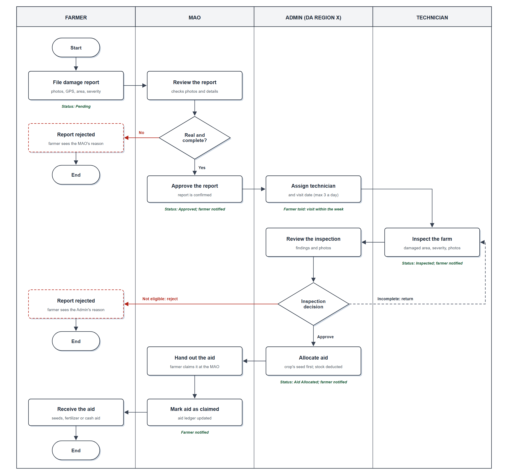

# CropGuard

**A real-time, web-based crop damage incident management system with analytics for the Department of Agriculture – Region X (Northern Mindanao).**

Farmers report crop damage from their phones. The Municipal Agriculture Office (MAO) checks each report, the DA schedules a technician to inspect the farm, and relief aid is allocated, handed out and tracked in one place, with every step visible to the farmer. Piloted for **Balingasag, Misamis Oriental**.

Capstone project of **Team POWER 18**, College of Information Technology Education, PHINMA – Cagayan de Oro College (2026).



---

## Who uses it

| Role | What they do |
|---|---|
| **Farmer** | Registers (email-verified, approved by the Admin), adds farms with GPS, files damage reports with photos, requests seeds, follows every report's status |
| **MAO** (Municipal Agriculture Office) | Approves or rejects reports (always with a reason), hands out relief aid and marks it claimed, updates seed requests |
| **Technician** | Sees assigned farm visits, inspects the farm, records the damaged area, severity and geotagged photos |
| **Admin** (DA Region X) | Approves farmer sign-ups, schedules technicians, reviews inspections, allocates aid, manages users, crops and inventory, reads the analytics |

## Features

**Reporting**
- Farmer self-registration with a 6-digit email code and Admin approval; RSBSA number in the official `##-##-##-###-######` format, with a duplicate-account warning
- Farms with GPS location and cropping season (wet / dry / year-round)
- Damage reports with up to 5 geotagged photos; each photo shows its distance from the farm
- Works offline: a report is saved on the phone and sent when the connection returns
- Crop age at the time of damage, from the planting date

**Validation and inspection**
- MAO approves or rejects each report; a rejection always carries a reason the farmer can read
- Technician scheduling on a calendar that allows at most 3 farm visits per technician per day
- Field inspection: damaged area (checked against the farm size), severity (Low / Moderate / High / Total Loss) and evidence photos
- Admin can return an incomplete inspection to the technician

**Relief aid**
- Loss estimate per report from the crop's production cost, area and severity
- Aid allocation with the farmer's own crop seed filled in first, a searchable item picker and live stock levels
- Distribution ledger: the MAO marks aid as claimed and the farmer is notified
- Seed requests from farmers, approved and tracked to pickup

**Monitoring**
- Dashboards for every role, damage heat map (Leaflet), charts (Chart.js)
- System reports with Excel export and print-ready layouts
- Audit log of every important action
- Notifications for farmers and staff, plus in-app messaging
- English and Tagalog throughout, Bisaya on the farmer pages

**Security**
- Passwords hashed with bcrypt; account lockout after 5 wrong attempts
- 30-minute idle timeout, enforced on the server
- Changing a password needs the current password and a code sent to the account's email
- Role checks on the server for protected actions; prepared statements for queries that take user input (a full SQL-injection review found no injectable query)
- Database credentials and API keys come from environment variables, never from the code

## Tech stack

| Layer | Technology |
|---|---|
| Backend | PHP 8 (mysqli, prepared statements), MySQL / MariaDB |
| Frontend | HTML, JavaScript, Tailwind CSS (CDN) |
| Libraries | SweetAlert2, Chart.js, Leaflet + Leaflet.heat, Turf.js, SheetJS (xlsx), Font Awesome |
| Email | Brevo HTTP API |
| Hosting | Railway (FrankenPHP), with a volume for uploaded photos |

## Running it locally (XAMPP)

1. Install [XAMPP](https://www.apachefriends.org/) with PHP 8 and start **Apache** and **MySQL**.
2. Clone the project into the web folder:
   ```
   cd C:\xampp\htdocs
   git clone https://github.com/cleibum2002/cropguard.git
   ```
3. In phpMyAdmin, create an empty database named **`crop_damage_system`** and import **`schema/cropguard_schema.sql`** (structure only, no data).
4. Create the first Admin account. Make a password hash:
   ```
   C:\xampp\php\php.exe -r "echo password_hash('ChooseAStrongPassword!', PASSWORD_DEFAULT);"
   ```
   then run this in phpMyAdmin's SQL tab, pasting the hash:
   ```sql
   INSERT INTO users (Role, Fullname, Email, Password, STATUS, Email_Verified)
   VALUES ('Admin', 'System Administrator', 'admin@example.com', '<paste the hash here>', 'Active', 1);
   ```
5. Open **http://localhost/cropguard/** and log in with that email and password. From the Admin pages you can add the MAO and Technician accounts, crops and relief items.

Locally the database settings default to XAMPP's (`localhost`, user `root`, no password, database `crop_damage_system`). Emails, such as sign-up and password codes, are only sent when `BREVO_API_KEY` is set.

## Configuration

All settings come from environment variables:

| Variable | Used for |
|---|---|
| `MYSQLHOST`, `MYSQLPORT`, `MYSQLUSER`, `MYSQLPASSWORD`, `MYSQLDATABASE` | Database connection. On Railway, set them as references to the MySQL service, e.g. `MYSQLHOST=${{MySQL.MYSQLHOST}}` |
| `BREVO_API_KEY` | Sending verification and notification emails |
| `BREVO_SENDER_EMAIL` | The sender address; it must be verified in Brevo |

On Railway, uploaded photos are stored on a volume mounted at `/app/uploads`.

## Tests

129 automated tests in 11 suites (plain PHP, no framework) cover registration and login, role access, the report workflow, scheduling, photo uploads, aid transactions, reports and the audit log. They run against the **local** database only and create and remove their own test data:

```
C:\xampp\php\php.exe tests\unit.php
C:\xampp\php\php.exe tests\system.php
```

Suites: `unit`, `integration`, `system`, `authentication`, `role_access`, `scheduling`, `personnel`, `photo_upload`, `transaction`, `reporting`, `audit_log`.

## Project structure

```
api/           PHP endpoints, grouped by area (auth, dashboard, masterfile, mao, technician, ...)
views/         Pages per role: farmers/, mao/, technician/, masterfile/ (Admin), profile/, communication/
assets/js/     Shared scripts: translations, session guard, navigation, photo viewer
schema/        Database structure (no data)
tests/         Automated test suites
docs/diagrams/ Use case, data flow, ER diagram and process flowchart (with the scripts that draw them)
```

## Diagrams

| | |
|---|---|
| [Process flowchart](docs/diagrams/J5_process_flowchart.png) | [Entity relationship diagram](docs/diagrams/J4_erd.png) |
| [Use case diagram](docs/diagrams/J1_use_case.png) | [Context diagram (DFD level 0)](docs/diagrams/J2_dfd_level0_context.png) |

## Team POWER 18

| Member | Role |
|---|---|
| **Angel Cleo A. Sumagang** ([@cleibum2002](https://github.com/cleibum2002)) | Lead Developer, Quality Assurance |
| Jaylyn Rose C. Sta. Rita | Developer |
| Earl Gian J. Lumansoc | Developer |
| Ruzzyll Jane B. Losanes | Project Manager, Documentation |
| Argiedan B. Salvo | UI/UX Designer |
| John Louise A. Zagado | UI/UX Designer |

**Adviser:** Faith Nave Dollera, MIT

## Acknowledgements

- Department of Agriculture – Regional Field Office X
- Municipal Agriculture Office of Balingasag, Misamis Oriental
- PHINMA – Cagayan de Oro College, College of Information Technology Education
- Sample crop photos in `docs/demo_photos` come from Wikimedia Commons; see [CREDITS.md](docs/demo_photos/CREDITS.md)

## License

© 2026 Team POWER 18. All rights reserved. This repository is shared for viewing and reference.
